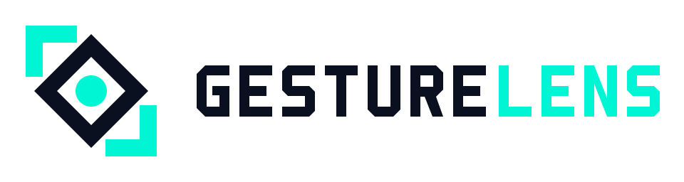
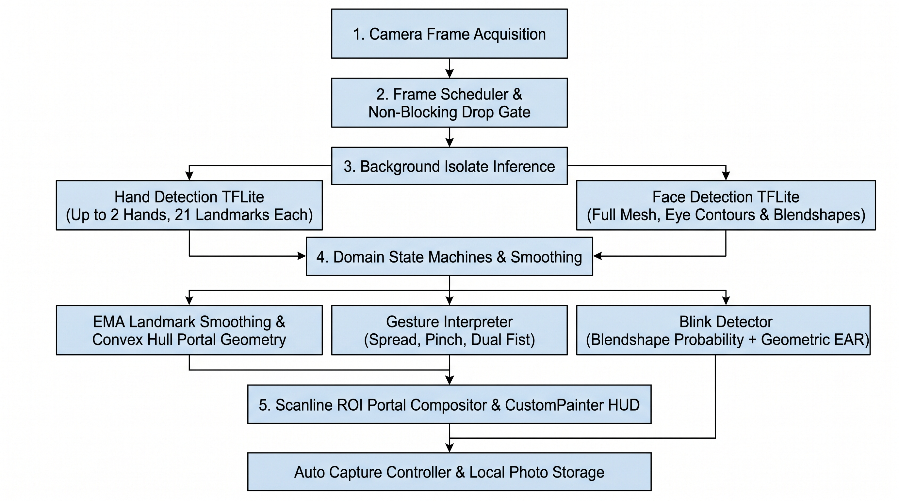

<div align="center">

<picture>
  <source media="(prefers-color-scheme: dark)" srcset="assets/logo/gesturelens-horizontal-on-dark.svg">
  <source media="(prefers-color-scheme: light)" srcset="assets/logo/gesturelens-horizontal.svg">
  
</picture>

<br/>
<br/>

**Real-time hand tracking portal filter and eye-blink auto-capture camera application built with Dart and Flutter. Supports Windows, macOS, Linux, and Android.**

<br/>

<!-- Tech Stack Badges -->
[](https://flutter.dev)
[](https://dart.dev)
[](https://www.tensorflow.org/lite)
[](https://developers.google.com/mediapipe)
[](#installation-and-setup)

<!-- Repository Status & Views Badges -->
[](LICENSE)
[](https://github.com/davizofficial/GestureLens/releases)
[](https://github.com/davizofficial/GestureLens)

</div>

---

## Overview

**GestureLens** is an interactive computer vision camera application implemented in **Dart** and **Flutter** that transforms live camera streams using real-time hand gestures and facial landmark analysis. Inspired by spatial portal camera concepts, GestureLens allows users to form a dynamic polygonal portal between their fingertips in mid-air. Visual effects are composited exclusively inside the boundaries of the hand-formed portal while the surrounding camera feed remains unaltered.

In addition to hand-driven spatial filters, GestureLens integrates real-time eye-blink detection powered by a 468-point facial mesh and blendshape probability evaluation. Users can capture high-contrast filtered photographs completely hands-free simply by blinking at the camera. All machine learning inference and pixel-level image processing run locally on the device without external server dependencies.

---

## UI Screenshots

> Coming soon.
 <!--
| 2D Polygonal Portal Mode | 3D Perspective Prism Mode |
| :---: | :---: |
|  |  |
| *Real-time convex portal geometry stretched between two hands with the Dual Tone filter active.* | *Multi-layered 3D perspective portal prism with interactive hand skeleton tracking.* |

| Clean View Mode (Hide UI) | Eye-Blink Auto Capture & Gallery |
| :---: | :---: |
|  |  |
| *Distraction-free camera canvas showing only the live camera feed and active portal visual effects.* | *Hands-free photo capture triggered by an eye blink and stored in the in-app session gallery.* | 

-->

---

## Demo Video

> Coming Soon

<!-- https://github.com/davizofficial/GestureLens/raw/main/docs/demo/gesturelens-demo.mp4

*Fallback file path*: [`docs/demo/gesturelens-demo.mp4`](docs/demo/gesturelens-demo.mp4)

### What the Demo Shows

1. **Portal Creation and Reshaping**: The user raises one or two hands in front of the camera. GestureLens tracks 21 3D landmarks per hand and constructs a live polygonal portal framed by the fingertips, dynamically scaling and rotating as the hands move.
2. **Pinch-to-Switch Filter Cycling**: The user performs a quick thumb-to-pinky pinch gesture to cycle through the 11 built-in pixel filters in real time without touching the screen or keyboard.
3. **2D to 3D Mode Transition**: The user closes both hands into fists simultaneously for a brief moment, switching the flat 2D portal polygon into a multi-layered 3D perspective prism.
4. **Clean View Toggle**: The user activates the **Hide UI** feature, removing all status overlays and control bars so only the moving camera stream and portal visual effects are displayed.
5. **Hands-Free Eye-Blink Photo Capture**: With **Auto Capture** enabled, the user blinks naturally at the camera. GestureLens detects the complete open-to-closed-to-open blink cycle, captures the composited frame, and saves the resulting image to the gallery. -->

---

## How It Works (Workflow)

GestureLens processes live camera frames through a five-stage non-blocking pipeline designed to maintain responsive UI rendering alongside intensive computer vision inference:



1. **Frame Acquisition and Format Normalization**: `CameraService` streams raw camera buffers from mobile or desktop cameras and converts them into a normalized RGB pixel buffer (`CameraFrameData`), applying horizontal mirror compensation for front-facing cameras.
2. **Throttled Frame Scheduling**: `FrameScheduler` acts as an asynchronous gatekeeper. If an inference pass is still in progress when a new camera frame arrives, the intermediate frame is dropped immediately to prevent memory backpressure and UI frame stutter.
3. **On-Device Isolate Inference**:
   - **Hand Tracking (`hand_detection`)**: Runs inside a dedicated background Dart isolate to detect palm bounding boxes and extract 21 3D hand keypoints per hand.
   - **Facial Landmark Tracking (`face_detection_tflite`)**: Extracts facial landmarks, 16-point eye contour meshes (`leftEye` and `rightEye`), and eye openness probabilities.
4. **Temporal Smoothing and State Evaluation**:
   - Raw landmark coordinates are filtered using an Exponential Moving Average (`EMA`) to eliminate jitter.
   - `PortalGeometryBuilder` computes the convex polygon spanning the active fingertips and projects depth layers when 3D mode is enabled.
   - `GestureInterpreter` and `BlinkDetector` evaluate debounced state machines with cooldown timers to prevent accidental filter switches or duplicate photo captures.
5. **Scanline ROI Compositing and Capture**: `PortalProcessor` computes the bounding box of the portal polygon and applies the selected pixel filter strictly to interior scanline spans. When a manual or blink-triggered capture occurs, the exact composited frame (including portal borders and 3D depth rings) is encoded to PNG and persisted to disk.

---

## Key Features

- **Dual-Hand 21-Point Landmark Tracking**: Tracks one or two hands concurrently with smooth skeletal rendering and normalized coordinate projection.
- **Interactive 2D and 3D Polygonal Portals**: Constructs a single-hand 5-point fingertip polygon or a two-hand 8-point framing aperture, with support for a multi-ring 3D perspective prism.
- **11 Real-Time Pixel-Level Portal Filters**:
  1. **Dual Tone**: High-contrast cyan and deep-navy luminance mapping.
  2. **Thermal**: Infrared-style heat map gradient based on pixel intensity.
  3. **Sketch**: Sobel-inspired grayscale pencil edge rendering.
  4. **Pixelate**: Dynamic mosaic block quantization inside the portal region.
  5. **Glitch**: Horizontal scanline displacement with RGB channel separation.
  6. **Invert**: Full RGB color inversion within the portal boundary.
  7. **Red Channel**: High-impact crimson channel isolation.
  8. **Edge Detection**: High-contrast neon structural edge extraction.
  9. **Blur**: Fast spatial box-blur softening filter.
  10. **Cartoon**: Quantized color posterization paired with bold dark outlines.
  11. **Rainbow Wave**: Phase-shifted sinusoidal chromatic wave modulation.
- **Touchless Gesture Controls**:
  - **Open Hand / Two-Hand Spread**: Opens, resizes, and rotates the active filter portal.
  - **Thumb-to-Pinky Pinch**: Cycles to the next visual filter with a 650 ms cooldown.
  - **Dual Closed Fists**: Toggles between 2D Portal Mode and 3D Portal Mode.
- **Hybrid Eye-Blink Auto Capture**: Combines MediaPipe eye-openness blendshapes with geometric Eye Aspect Ratio (EAR) calculation across the 16-point eye contour mesh to reliably trigger hands-free photo capture.
- **Clean View Mode (Hide Visual UI)**: Collapses all status indicators and control panels so the viewport displays only the live camera feed and interactive visual effects.
- **Built-in Session Gallery**: Browse, inspect, and manage captured PNG photos directly within the application.

---

## System Requirements

### Minimum Hardware Requirements
- **Camera**: Integrated webcam or external USB camera (Desktop) / Front or rear camera (Android).
- **Processor**: 64-bit multi-core CPU (x86_64 or ARM64) capable of running TensorFlow Lite CPU/XNNPACK delegates.
- **Memory**: Minimum 4 GB RAM (8 GB RAM recommended for desktop builds).

### Software Requirements (For Building from Source)
- **Flutter SDK**: Version `3.24.0` or higher (Dart SDK `3.5.0+`).
- **Android**: Android SDK Platform 24+ (Android 7.0 Nougat or newer); physical landscape orientation on mobile phones.
- **Linux**: GTK 3 development headers and GStreamer 1.0 development libraries (`libgstreamer1.0-dev`, `libgstreamer-plugins-base1.0-dev`).
- **Windows**: Windows 10/11 (64-bit) with Visual Studio 2022 ("Desktop development with C++" workload).
- **macOS**: macOS 12.0 (Monterey) or newer with Xcode 14+ and CocoaPods.

---

## Installation and Setup

### Option 1: Direct Android APK Download (Recommended for Android Users)

You do not need to build the project from source to run GestureLens on an Android device. Pre-compiled APK packages are provided on the GitHub Releases page:

1. Navigate to the [**GitHub Releases**](https://github.com/davizofficial/GestureLens/releases) page of this repository.
2. Under the latest release, download the `GestureLens-release.apk` file to your Android phone.
3. Open the downloaded `.apk` file and grant permission to install applications from your browser or file manager if prompted.
4. Launch **GestureLens**, grant camera permission, and rotate your phone to **landscape orientation** to start tracking.

---

### Option 2: Building from Source (All Platforms)

Because this repository tracks only the core Dart source code (`lib/`), package manifest (`pubspec.yaml`), and documentation to keep the repository lightweight, generate the platform-specific runner directories locally before compiling:

#### Step 1: Clone and Initialize Project Runners
```bash
git clone https://github.com/davizofficial/GestureLens.git
cd GestureLens

# Generate native platform runner directories (android, linux, windows, macos)
flutter create --project-name GestureLens .

# Install Dart and Flutter dependencies
flutter pub get
```

#### Step 2: Platform-Specific Configuration and Execution

##### Linux
Install the required GStreamer development packages used by `camera_desktop`, then run the application:
```bash
sudo apt update
sudo apt install -y clang cmake ninja-build pkg-config libgtk-3-dev \
  libgstreamer1.0-dev libgstreamer-plugins-base1.0-dev gstreamer1.0-plugins-good

flutter run -d linux
```

##### Windows
Ensure Visual Studio 2022 with the **Desktop development with C++** workload is installed, then run in PowerShell or Command Prompt:
```bash
flutter config --enable-windows-desktop
flutter run -d windows
```

##### macOS
Ensure Xcode and CocoaPods are installed, and verify that `<key>NSCameraUsageDescription</key>` is present in `macos/Runner/Info.plist`:
```bash
flutter config --enable-macos-desktop
flutter run -d macos
```

##### Android (Build from Source)
Ensure `<uses-permission android:name="android.permission.CAMERA" />` is declared inside `android/app/src/main/AndroidManifest.xml` and `minSdk` is set to at least `24` in `android/app/build.gradle`:
```bash
# Run on a connected Android device
flutter run -d android

# Or build a standalone release APK
flutter build apk --release
```

---

## Keyboard Shortcuts (Desktop)

| Key | Action |
| :--- | :--- |
| `Left Arrow` / `Right Arrow` | Switch to the previous / next portal filter |
| `M` | Toggle between 2D Portal Mode and 3D Portal Mode |
| `B` | Enable or disable Eye-Blink Auto Capture |
| `S` | Show or hide the 21-point hand skeleton overlay |
| `H` / `Esc` | Toggle Clean View Mode (Hide or Show UI controls) |
| `Space` | Trigger manual photo capture |

---

## Contributing

Contributions from the developer community are welcome and appreciated. Whether you are adding new scanline portal filters, optimizing isolate inference throughput, or improving platform compatibility, please follow these steps:

1. **Fork the repository** to your own GitHub account.
2. **Create a feature branch** from `main`:
   ```bash
   git checkout -b feat/feature-name
   ```
3. **Implement your changes** inside `lib/` following the existing Clean Architecture feature separation (`domain/`, `data/`, `presentation/`).
4. **Verify code quality** before committing:
   ```bash
   flutter analyze
   ```
5. **Commit your changes** with a clear, descriptive commit message:
   ```bash
   git commit -m "feat(effects): add chromatic aberration portal filter"
   ```
6. **Push to your fork** and open a **Pull Request** against the `main` branch.

---

## Support and Feedback

If you encounter any issues, have questions about the computer vision pipeline, or want to propose new gesture interactions:

- **Bug Reports & Feature Requests**: Open a ticket in [**GitHub Issues**](https://github.com/davizofficial/GestureLens/issues).
- **Questions & Community Discussion**: Start or join a thread in [**GitHub Discussions**](https://github.com/davizofficial/GestureLens/discussions).

---

## License

This project is licensed under the **MIT License**. See the [LICENSE](LICENSE) file for full license text and permissions.

---

## Author

Developed and maintained by **[Daviz Arva](https://github.com/davizofficial)**.

---

## Acknowledgments and Inspiration

Special thanks to the open-source developers and researchers whose work inspired and enabled this project:

- **[Retrolens by syahdanfx](https://github.com/syahdanfx/Retrolens)**: Thank you to the developer of Retrolens, which served as the primary inspiration for the interactive hand-framed polygonal portal filter, pinch-to-switch filter cycling, and 2D/3D spatial portal concepts re-engineered here in Dart and Flutter.
- **[hand_detection](https://pub.dev/packages/hand_detection) & [face_detection_tflite](https://pub.dev/packages/face_detection_tflite) ([cornpip](https://github.com/cornpip))**: For providing the on-device TensorFlow Lite / LiteRT Dart bindings used for background isolate hand landmark and facial mesh inference.
- **[Google MediaPipe](https://github.com/google-ai-edge/mediapipe)**: For the underlying Palm Detection, 21-point Hand Landmark, and 468-point Face Mesh machine learning models.
- **[logo-design-skill by kaankiziltug](https://github.com/kaankiziltug/logo-design-skill)**: For the vector design audit and asset generation workflow used to craft the GestureLens brand identity.

